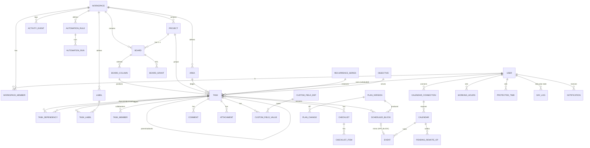

# Data Model, Architecture, API, Security and Deployment

Sections 17–20 of the blueprint. The current schema is
`packages/db/prisma/schema.prisma` [F3]. This section specifies the **target** schema
as a delta from it. SQL is PostgreSQL 16 DDL at migration level. The Prisma models are
to be written to match, following the repository's conventions (cuid ids,
`timestamptz(3)`, `@@map` snake_case).

---

## 17. Data model

### 17.1 Single source of truth: how one task appears everywhere

| Where the task appears | What is stored | Table / column | Owner of the data |
|---|---|---|---|
| Project board | Column and order | `tasks.board_id`, `tasks.column_id`, `tasks.position` | Project members |
| My Day / Week | Day and order in that day | `tasks.planned_for`, `tasks.day_order` | The task's owner |
| Calendar | 0..n sessions | `scheduled_blocks(task_id, starts_at, ends_at, state, is_pinned)` | Engine (or the human if pinned) |
| External calendar | Mirror event per session | `events(origin='APP_BLOCK')` ↔ `scheduled_blocks.event_id` | Fluid |
| Search, List, Table, Timeline | Nothing extra (queries) | — | — |
| Daily log | Frozen counts at shutdown | `day_logs` | Owner |

Title, estimate, deadline, priority, labels and so on exist **only** on `tasks` and its
child tables. No view writes a copy.

### 17.2 Entity list and changes from today

| Entity | Status | Notes |
|---|---|---|
| `users`, `sessions`, `user_preferences` | exists | Add `default_workspace_id`, `scheduling_mode`, `hybrid_threshold`, `horizon_days`, `max_daily_work_minutes`, `default_estimate_minutes` |
| `workspaces`, `workspace_members` | **new** | Tenant boundary |
| `areas` | change | `user_id` → `workspace_id` (+ optional `owner_user_id` for personal areas) |
| `projects` | change | + `workspace_id`, `importance`, `archived_at`, `deleted_at`, `version` |
| `boards`, `board_columns`, `board_grants` | **new** | |
| `tasks` | change | + `workspace_id`, `board_id`, `column_id`, `position`, `owner_id`, `created_by_id`, `deadline_kind`, `auto_schedule`, `preferred_window`, `series_id`, `deleted_at`, `version`, `short_id`, `search_tsv`. `status` is kept as a denormalised status category (derived from the column) for engine and query speed |
| `task_members` | **new** | Collaborators |
| `task_dependencies` | exists | + `workspace_id` |
| `labels`, `task_labels` | **new** | |
| `checklists`, `checklist_items` | **new** | |
| `comments` | **new** | |
| `attachments` | **new** | Metadata. Blobs in object storage |
| `custom_field_defs`, `custom_field_values` | **new** (P2) | |
| `recurrence_series` | **new** (P4) | |
| `objectives` | change | + `workspace_id`, `owner_id` |
| `day_logs` | exists | + `objectives_text`, `planning_note` |
| `calendar_connections`, `calendars`, `events` | exists | Stay **user-scoped**: calendars belong to people, not workspaces |
| `scheduled_blocks` | change | + `owner_id`, `version`, `state` adds `MISSED`, `REMOVED_EXTERNALLY`; + `explanation jsonb` |
| `plan_versions`, `plan_changes` | change | + `auto_applied`, `disruption_score`, `overtime_proposals jsonb` |
| `working_hours`, `energy_windows`, `protected_times` | exists | User-scoped |
| `scheduling_rules` | **new** (P4) | |
| `pending_remote_ops`, `sync_logs`, `sync_conflicts` | exists | |
| `notifications`, `notification_prefs` | **new** | |
| `automation_rules`, `automation_runs` | **new** (P4) | |
| `activity_events` | **new** | Append-only; replaces ad-hoc per-feature logs for cards |
| `ai_settings`, `ai_actions` | exists | `ai_actions` stays as the calendar-agent log |
| `ai_operation_logs` | **new** (P5) | Assistant ops |
| `saved_views` | **new** (P1) | |
| `api_tokens`, `webhook_endpoints`, `webhook_deliveries` | **new** (P4) | |
| `audit_logs` | exists | Security events (logins, token use, admin actions) |

### 17.3 ER diagram (core)



### 17.4 Core DDL

Conventions:
- `id text` cuid primary keys.
- Every tenant table carries `workspace_id`, and FKs to tenant rows are **composite `(workspace_id, id)`** so a row can never reference another tenant's row, even through a bug.
- Soft delete is `deleted_at`.
- Optimistic concurrency is `version int`, incremented on every update by trigger.
- **Naming:** this repository's Prisma models produce *quoted camelCase* columns (for example `"estimateMinutes"`, `"plannedFor"`, `"userId"` in `migrations/20260810120802_init`). Existing columns are referenced that way below. New columns and tables are written in snake_case for readability. When implemented as Prisma models they should follow the repository convention: camelCase fields, `@@map` for table names. Use the Prisma-generated column names in the hand-written SQL parts (triggers, RLS, exclusion constraints).

```sql
-- ── Tenancy ────────────────────────────────────────────────────────────────
CREATE TYPE workspace_role AS ENUM ('OWNER','ADMIN','MEMBER','GUEST');

CREATE TABLE workspaces (
  id            text PRIMARY KEY,
  name          text NOT NULL CHECK (length(name) BETWEEN 1 AND 120),
  slug          text NOT NULL UNIQUE,
  is_personal   boolean NOT NULL DEFAULT false,
  ai_policy     jsonb NOT NULL DEFAULT '{"enabled": true}',
  created_at    timestamptz(3) NOT NULL DEFAULT now(),
  updated_at    timestamptz(3) NOT NULL DEFAULT now(),
  deleted_at    timestamptz(3)
);

CREATE TABLE workspace_members (
  workspace_id  text NOT NULL REFERENCES workspaces(id) ON DELETE CASCADE,
  user_id       text NOT NULL REFERENCES users(id) ON DELETE CASCADE,
  role          workspace_role NOT NULL DEFAULT 'MEMBER',
  workload_visibility text NOT NULL DEFAULT 'BUSY_ONLY'
                CHECK (workload_visibility IN ('FULL','BUSY_ONLY','HIDDEN')),
  joined_at     timestamptz(3) NOT NULL DEFAULT now(),
  PRIMARY KEY (workspace_id, user_id)
);
CREATE INDEX ON workspace_members (user_id);
-- Exactly one OWNER per workspace
CREATE UNIQUE INDEX one_owner_per_workspace ON workspace_members (workspace_id) WHERE role = 'OWNER';

-- ── Projects and boards ───────────────────────────────────────────────────
ALTER TABLE projects
  ADD COLUMN workspace_id text,                          -- backfilled, then SET NOT NULL
  ADD COLUMN importance   smallint NOT NULL DEFAULT 1 CHECK (importance BETWEEN 0 AND 2),
  ADD COLUMN archived_at  timestamptz(3),
  ADD COLUMN deleted_at   timestamptz(3),
  ADD COLUMN version      int NOT NULL DEFAULT 1;
ALTER TABLE projects ADD CONSTRAINT projects_ws_id_uq UNIQUE (workspace_id, id);

CREATE TYPE status_category AS ENUM ('BACKLOG','TODO','IN_PROGRESS','DONE');

CREATE TABLE boards (
  id            text PRIMARY KEY,
  workspace_id  text NOT NULL REFERENCES workspaces(id) ON DELETE CASCADE,
  project_id    text,
  name          text NOT NULL CHECK (length(name) BETWEEN 1 AND 120),
  visibility    text NOT NULL DEFAULT 'WORKSPACE' CHECK (visibility IN ('WORKSPACE','PRIVATE')),
  position      text NOT NULL COLLATE "C",             -- fractional index among the project's boards
  template_of   text,                                  -- non-null = this row is a template
  archived_at   timestamptz(3),
  deleted_at    timestamptz(3),
  version       int NOT NULL DEFAULT 1,
  created_at    timestamptz(3) NOT NULL DEFAULT now(),
  updated_at    timestamptz(3) NOT NULL DEFAULT now(),
  UNIQUE (workspace_id, id),
  FOREIGN KEY (workspace_id, project_id) REFERENCES projects (workspace_id, id) ON DELETE SET NULL (project_id)
);
CREATE INDEX ON boards (workspace_id, project_id, position) WHERE deleted_at IS NULL;

CREATE TABLE board_columns (
  id              text PRIMARY KEY,
  workspace_id    text NOT NULL,
  board_id        text NOT NULL,
  name            text NOT NULL CHECK (length(name) BETWEEN 1 AND 80),
  position        text NOT NULL COLLATE "C",
  status_category status_category,                     -- null = no workflow semantics
  wip_limit       int CHECK (wip_limit IS NULL OR wip_limit > 0),
  auto_schedule   boolean,                             -- null = inherit user default
  on_complete_move_to text,                            -- column id on the same board
  requires_approval_role workspace_role,
  archived_at     timestamptz(3),
  deleted_at      timestamptz(3),
  version         int NOT NULL DEFAULT 1,
  UNIQUE (workspace_id, id),
  FOREIGN KEY (workspace_id, board_id) REFERENCES boards (workspace_id, id) ON DELETE CASCADE
);
CREATE INDEX ON board_columns (board_id, position) WHERE deleted_at IS NULL;

CREATE TABLE board_grants (
  id            text PRIMARY KEY,
  workspace_id  text NOT NULL,
  board_id      text NOT NULL,
  principal_type text NOT NULL CHECK (principal_type IN ('USER','GROUP','WORKSPACE_MEMBERS')),
  principal_id  text,                                  -- null for WORKSPACE_MEMBERS
  permission    text NOT NULL CHECK (permission IN ('READ','COMMENT','EDIT','MANAGE')),
  FOREIGN KEY (workspace_id, board_id) REFERENCES boards (workspace_id, id) ON DELETE CASCADE,
  UNIQUE (board_id, principal_type, principal_id)
);

-- ── Tasks (delta) ─────────────────────────────────────────────────────────
CREATE TYPE deadline_kind AS ENUM ('SOFT','HARD');

ALTER TABLE tasks
  ADD COLUMN workspace_id     text,                    -- backfilled, then NOT NULL
  ADD COLUMN board_id         text,
  ADD COLUMN column_id        text,
  ADD COLUMN position         text COLLATE "C",
  ADD COLUMN owner_id         text REFERENCES users(id) ON DELETE SET NULL,
  ADD COLUMN created_by_id    text REFERENCES users(id) ON DELETE SET NULL,
  ADD COLUMN deadline_kind    deadline_kind NOT NULL DEFAULT 'SOFT',
  ADD COLUMN auto_schedule    boolean,                 -- null = inherit column → user
  ADD COLUMN preferred_window text,                    -- MORNING|AFTERNOON|EVENING|HH:MM-HH:MM
  ADD COLUMN series_id        text,
  ADD COLUMN short_id         int,                     -- per-workspace human id (#123)
  ADD COLUMN deleted_at       timestamptz(3),
  ADD COLUMN version          int NOT NULL DEFAULT 1,
  ADD COLUMN search_tsv       tsvector GENERATED ALWAYS AS
      (setweight(to_tsvector('simple', coalesce(title,'')), 'A') ||
       setweight(to_tsvector('simple', coalesce(notes,'')), 'B')) STORED;
-- estimate becomes nullable so "no estimate" is representable (REQ-TASK-EST)
ALTER TABLE tasks ALTER COLUMN "estimateMinutes" DROP NOT NULL, ALTER COLUMN "estimateMinutes" DROP DEFAULT;

ALTER TABLE tasks ADD CONSTRAINT tasks_ws_id_uq UNIQUE (workspace_id, id);
ALTER TABLE tasks ADD CONSTRAINT tasks_board_fk  FOREIGN KEY (workspace_id, board_id)  REFERENCES boards (workspace_id, id);
ALTER TABLE tasks ADD CONSTRAINT tasks_column_fk FOREIGN KEY (workspace_id, column_id) REFERENCES board_columns (workspace_id, id);
ALTER TABLE tasks ADD CONSTRAINT tasks_board_column_together CHECK ((board_id IS NULL) = (column_id IS NULL));
ALTER TABLE tasks ADD CONSTRAINT tasks_estimate_positive CHECK ("estimateMinutes" IS NULL OR "estimateMinutes" BETWEEN 1 AND 10080);
CREATE UNIQUE INDEX tasks_short_id_uq ON tasks (workspace_id, short_id);

-- Hot paths
CREATE INDEX tasks_board_order   ON tasks (column_id, position) WHERE deleted_at IS NULL AND "archivedAt" IS NULL;
CREATE INDEX tasks_owner_open    ON tasks (owner_id, "plannedFor", "dayOrder") WHERE "completedAt" IS NULL AND deleted_at IS NULL;
CREATE INDEX tasks_ws_deadline   ON tasks (workspace_id, deadline) WHERE "completedAt" IS NULL AND deleted_at IS NULL;
CREATE INDEX tasks_search        ON tasks USING gin (search_tsv);
CREATE INDEX tasks_title_trgm    ON tasks USING gin (title gin_trgm_ops);   -- requires pg_trgm

-- A column must belong to the task's board (trigger, since the FK can't express it)
CREATE FUNCTION tasks_column_on_board() RETURNS trigger LANGUAGE plpgsql AS $$
BEGIN
  IF NEW.column_id IS NOT NULL AND NOT EXISTS
     (SELECT 1 FROM board_columns c WHERE c.id = NEW.column_id AND c.board_id = NEW.board_id) THEN
    RAISE EXCEPTION 'column % is not on board %', NEW.column_id, NEW.board_id;
  END IF;
  RETURN NEW;
END $$;
CREATE TRIGGER tasks_column_on_board BEFORE INSERT OR UPDATE OF column_id, board_id ON tasks
  FOR EACH ROW EXECUTE FUNCTION tasks_column_on_board();

-- Generic optimistic-concurrency bump (attach to every versioned table)
CREATE FUNCTION bump_version() RETURNS trigger LANGUAGE plpgsql AS $$
BEGIN NEW.version := OLD.version + 1; NEW.updated_at := now(); RETURN NEW; END $$;

CREATE TABLE task_members (
  workspace_id text NOT NULL,
  task_id      text NOT NULL,
  user_id      text NOT NULL REFERENCES users(id) ON DELETE CASCADE,
  role         text NOT NULL DEFAULT 'COLLABORATOR' CHECK (role IN ('COLLABORATOR','WATCHER')),
  PRIMARY KEY (task_id, user_id),
  FOREIGN KEY (workspace_id, task_id) REFERENCES tasks (workspace_id, id) ON DELETE CASCADE
);

-- ── Labels, checklists, comments, attachments ─────────────────────────────
CREATE TABLE labels (
  id text PRIMARY KEY, workspace_id text NOT NULL REFERENCES workspaces(id) ON DELETE CASCADE,
  board_id text,                                       -- null = workspace-wide
  name text NOT NULL CHECK (length(name) BETWEEN 1 AND 50), color text NOT NULL,
  UNIQUE (workspace_id, id), UNIQUE (workspace_id, board_id, name)
);
CREATE TABLE task_labels (
  workspace_id text NOT NULL, task_id text NOT NULL, label_id text NOT NULL,
  PRIMARY KEY (task_id, label_id),
  FOREIGN KEY (workspace_id, task_id)  REFERENCES tasks  (workspace_id, id) ON DELETE CASCADE,
  FOREIGN KEY (workspace_id, label_id) REFERENCES labels (workspace_id, id) ON DELETE CASCADE
);
CREATE INDEX ON task_labels (label_id);

CREATE TABLE checklists (
  id text PRIMARY KEY, workspace_id text NOT NULL, task_id text NOT NULL,
  title text NOT NULL DEFAULT 'Checklist', position text NOT NULL COLLATE "C",
  UNIQUE (workspace_id, id),
  FOREIGN KEY (workspace_id, task_id) REFERENCES tasks (workspace_id, id) ON DELETE CASCADE
);
CREATE TABLE checklist_items (
  id text PRIMARY KEY, workspace_id text NOT NULL, checklist_id text NOT NULL,
  text text NOT NULL CHECK (length(text) BETWEEN 1 AND 500),
  position text NOT NULL COLLATE "C", checked_at timestamptz(3), checked_by_id text,
  assignee_id text, due_at timestamptz(3),               -- P2 (advanced checklists)
  promoted_task_id text,                                 -- set when promoted to a subtask
  version int NOT NULL DEFAULT 1,
  FOREIGN KEY (workspace_id, checklist_id) REFERENCES checklists (workspace_id, id) ON DELETE CASCADE
);
CREATE INDEX ON checklist_items (checklist_id, position);

CREATE TABLE comments (
  id text PRIMARY KEY, workspace_id text NOT NULL, task_id text NOT NULL,
  author_id text REFERENCES users(id) ON DELETE SET NULL,
  parent_id text, body_md text NOT NULL CHECK (length(body_md) <= 20000),
  created_at timestamptz(3) NOT NULL DEFAULT now(), edited_at timestamptz(3), deleted_at timestamptz(3),
  FOREIGN KEY (workspace_id, task_id) REFERENCES tasks (workspace_id, id) ON DELETE CASCADE
);
CREATE INDEX ON comments (task_id, created_at);

CREATE TABLE attachments (
  id text PRIMARY KEY, workspace_id text NOT NULL, task_id text NOT NULL,
  uploader_id text REFERENCES users(id) ON DELETE SET NULL,
  storage_key text NOT NULL UNIQUE,                      -- object-store key; never user-controlled
  filename text NOT NULL, content_type text NOT NULL, size_bytes bigint NOT NULL CHECK (size_bytes > 0),
  sha256 text NOT NULL, scan_status text NOT NULL DEFAULT 'PENDING'
         CHECK (scan_status IN ('PENDING','CLEAN','INFECTED','SKIPPED')),
  created_at timestamptz(3) NOT NULL DEFAULT now(), deleted_at timestamptz(3),
  FOREIGN KEY (workspace_id, task_id) REFERENCES tasks (workspace_id, id) ON DELETE CASCADE
);

-- ── Custom fields (P2) ────────────────────────────────────────────────────
CREATE TABLE custom_field_defs (
  id text PRIMARY KEY, workspace_id text NOT NULL REFERENCES workspaces(id) ON DELETE CASCADE,
  board_id text, name text NOT NULL, kind text NOT NULL
    CHECK (kind IN ('TEXT','NUMBER','DATE','CHECKBOX','SELECT','MULTI_SELECT','USER','URL')),
  options jsonb, position text NOT NULL COLLATE "C", UNIQUE (workspace_id, id)
);
CREATE TABLE custom_field_values (
  workspace_id text NOT NULL, task_id text NOT NULL, field_id text NOT NULL,
  v_text text, v_number numeric, v_date timestamptz(3), v_bool boolean, v_json jsonb,
  PRIMARY KEY (task_id, field_id),
  FOREIGN KEY (workspace_id, task_id)  REFERENCES tasks (workspace_id, id) ON DELETE CASCADE,
  FOREIGN KEY (workspace_id, field_id) REFERENCES custom_field_defs (workspace_id, id) ON DELETE CASCADE
);

-- ── Recurrence (P4) ───────────────────────────────────────────────────────
CREATE TABLE recurrence_series (
  id text PRIMARY KEY, workspace_id text NOT NULL REFERENCES workspaces(id) ON DELETE CASCADE,
  template_task_id text NOT NULL,                       -- snapshot fields copied into each instance
  rrule text NOT NULL,                                  -- authored by us; RFC 5545 subset
  dtstart_local timestamp NOT NULL, time_zone text NOT NULL,
  on_non_working_day text NOT NULL DEFAULT 'PREVIOUS_WORKING_DAY'
    CHECK (on_non_working_day IN ('SKIP','PREVIOUS_WORKING_DAY','NEXT_WORKING_DAY')),
  next_occurrence_local timestamp, ended_at timestamptz(3)
);
-- Exactly one open instance per series
CREATE UNIQUE INDEX one_open_instance ON tasks (series_id) WHERE series_id IS NOT NULL AND "completedAt" IS NULL AND deleted_at IS NULL;

-- ── Scheduling (delta) ────────────────────────────────────────────────────
ALTER TYPE "BlockState" ADD VALUE 'MISSED';
ALTER TYPE "BlockState" ADD VALUE 'REMOVED_EXTERNALLY';
ALTER TABLE scheduled_blocks
  ADD COLUMN owner_id text REFERENCES users(id) ON DELETE CASCADE,
  ADD COLUMN chunk_index int NOT NULL DEFAULT 1,
  ADD COLUMN version int NOT NULL DEFAULT 1,
  ADD COLUMN explanation jsonb,
  ADD COLUMN overlap_ack boolean NOT NULL DEFAULT false,  -- user confirmed placing over busy time
  ADD CONSTRAINT block_positive CHECK ("endsAt" > "startsAt");
CREATE INDEX blocks_owner_time ON scheduled_blocks (owner_id, "startsAt") WHERE state IN ('PROPOSED','ACCEPTED');
-- No two live sessions for one owner may overlap (defence in depth behind the engine)
CREATE EXTENSION IF NOT EXISTS btree_gist;
ALTER TABLE scheduled_blocks ADD CONSTRAINT no_overlap_per_owner
  EXCLUDE USING gist (owner_id WITH =, tstzrange("startsAt","endsAt") WITH &&)
  WHERE (state = 'ACCEPTED' AND NOT overlap_ack);
-- Sessions the user explicitly placed over busy time (overlap_ack = true) are exempt; see §17.6.

ALTER TABLE plan_versions
  ADD COLUMN auto_applied boolean NOT NULL DEFAULT false,
  ADD COLUMN disruption_score numeric(6,2),
  ADD COLUMN overtime_proposals jsonb,
  ADD COLUMN input_digest text;                         -- sha256 of canonical engine input (reproducibility)
ALTER TABLE users ADD COLUMN plan_epoch bigint NOT NULL DEFAULT 0;

-- ── Activity (append-only) ────────────────────────────────────────────────
CREATE TABLE activity_events (
  id            bigint GENERATED ALWAYS AS IDENTITY PRIMARY KEY,
  workspace_id  text NOT NULL,
  entity_type   text NOT NULL,                          -- task|board|column|project|comment|block
  entity_id     text NOT NULL,
  task_id       text,                                   -- denormalised for card feeds
  actor_id      text,                                   -- null for system
  source        text NOT NULL CHECK (source IN ('USER','ENGINE','AUTOMATION','AI','SYNC','IMPORT','API')),
  source_ref    text,                                   -- plan_version_id | rule_id | ai_op_id | sync_log_id
  verb          text NOT NULL,                          -- created|updated|moved|completed|deleted|restored|…
  diff          jsonb NOT NULL,                         -- {field: [before, after]}
  entity_version int,
  causation     text[],                                 -- automation loop protection
  created_at    timestamptz(3) NOT NULL DEFAULT now()
) PARTITION BY RANGE (created_at);
CREATE INDEX ON activity_events (workspace_id, created_at DESC);
CREATE INDEX ON activity_events (task_id, created_at DESC);
-- Monthly partitions; retention: 24 months managed, configurable self-hosted.
REVOKE UPDATE, DELETE ON activity_events FROM app_rw;    -- append-only for the app role

-- ── Notifications, views, automation, API (abridged) ──────────────────────
CREATE TABLE notifications (
  id text PRIMARY KEY, user_id text NOT NULL REFERENCES users(id) ON DELETE CASCADE,
  workspace_id text, kind text NOT NULL, payload jsonb NOT NULL, dedupe_key text,
  read_at timestamptz(3), created_at timestamptz(3) NOT NULL DEFAULT now(),
  UNIQUE (user_id, dedupe_key)
);
CREATE INDEX ON notifications (user_id, read_at, created_at DESC);

CREATE TABLE saved_views (
  id text PRIMARY KEY, workspace_id text NOT NULL, owner_id text, -- null owner = shared
  name text NOT NULL, layout text NOT NULL, query text NOT NULL, group_by text, sort jsonb, ui jsonb
);

CREATE TABLE automation_rules (
  id text PRIMARY KEY, workspace_id text NOT NULL, board_id text, name text NOT NULL,
  enabled boolean NOT NULL DEFAULT true, trigger jsonb NOT NULL, conditions text,
  actions jsonb NOT NULL, run_as text NOT NULL, max_runs_per_hour int NOT NULL DEFAULT 100,
  version int NOT NULL DEFAULT 1, created_by_id text, disabled_reason text
);
CREATE INDEX ON automation_rules (workspace_id, (trigger->>'kind')) WHERE enabled;
CREATE TABLE automation_runs (
  id bigint GENERATED ALWAYS AS IDENTITY PRIMARY KEY, rule_id text NOT NULL, rule_version int NOT NULL,
  trigger_event_id bigint, status text NOT NULL, actions_taken jsonb, error text,
  started_at timestamptz(3) NOT NULL DEFAULT now(), finished_at timestamptz(3)
);

CREATE TABLE api_tokens (
  id text PRIMARY KEY, user_id text NOT NULL REFERENCES users(id) ON DELETE CASCADE,
  workspace_id text NOT NULL, name text NOT NULL, token_digest text NOT NULL UNIQUE,  -- SHA-256, never the token
  scopes text[] NOT NULL, board_ids text[], expires_at timestamptz(3), last_used_at timestamptz(3), revoked_at timestamptz(3)
);
CREATE TABLE webhook_endpoints (
  id text PRIMARY KEY, workspace_id text NOT NULL, url text NOT NULL, encrypted_secret text NOT NULL,
  events text[] NOT NULL, board_ids text[], enabled boolean NOT NULL DEFAULT true,
  consecutive_failures int NOT NULL DEFAULT 0, disabled_at timestamptz(3)
);
CREATE TABLE webhook_deliveries (
  id text PRIMARY KEY, endpoint_id text NOT NULL REFERENCES webhook_endpoints(id) ON DELETE CASCADE,
  event_id text NOT NULL, attempt int NOT NULL, status_code int, response_ms int, error text,
  next_attempt_at timestamptz(3), created_at timestamptz(3) NOT NULL DEFAULT now(),
  UNIQUE (endpoint_id, event_id, attempt)
);
```

### 17.5 Ownership boundaries and deletion behaviour

| Deleting… | Effect |
|---|---|
| User | Personal workspace cascades. Memberships removed. Owned tasks in shared workspaces: `owner_id` → NULL (cards survive, unassigned). Calendar connections, events and blocks cascade. Activity keeps `actor_id` as an opaque id (rendered "Former member") |
| Workspace | Soft delete. 30-day recovery. Then hard delete cascades all tenant rows and object-store prefix |
| Project | Soft delete. Boards follow. Tasks follow. A restore restores all |
| Board | Soft delete with tasks. Moving tasks out first is offered |
| Column | Not allowed while it holds non-deleted cards. UI offers "move cards to…" first (Deck allows deleting stacks; we prefer an explicit move) |
| Task | Soft delete. Future sessions released (outbox deletes mirrors). Subtasks soft-deleted with the parent. Dependencies kept but inert. Purged after 30 days, then cascade |
| Label | Hard delete; `task_labels` cascade. Activity records the removal on each task |
| Area | `SET NULL` on tasks and projects (exists; F2 §9) |
| Calendar connection | Disconnected status. Events retained read-only for history (exists). Mirror blocks stay in Fluid |

### 17.6 Concurrency and integrity

- **Optimistic concurrency:** clients send `If-Match: <version>`. Updates use `UPDATE … WHERE id=$1 AND version=$2`. Zero rows means 409 with the current row.
- **Ordering:** fractional string positions (`position COLLATE "C"`), generated between neighbours. A rebalance job runs when a key exceeds 64 chars.
- **Engine writes** use the per-owner advisory lock plus `users.plan_epoch` (§13.D).
- **Overlap safety net:** the exclusion constraint above makes double-booking *accepted engine sessions* impossible at the DB level. Pinned overlaps that the user explicitly confirmed carry `overlap_ack = true` and are exempted by making the constraint `WHERE (state='ACCEPTED' AND NOT overlap_ack)`.
- **Existing guards kept:** event-origin immutability and engine-only `APP_BLOCK` writes (DB triggers) [F2].

### 17.7 Multi-tenancy and isolation

1. **Application layer.** Every repository function takes a `TenantContext {userId, workspaceId, role}` resolved from the session. Queries always filter by `workspace_id`. A lint rule forbids raw Prisma calls on tenant tables outside repositories (same pattern as the existing `events` repository vocabulary).
2. **Composite FKs** (above) make cross-tenant references structurally impossible.
3. **Postgres row-level security (defence in depth, P1):** `ALTER TABLE tasks ENABLE ROW LEVEL SECURITY; CREATE POLICY ws ON tasks USING (workspace_id = current_setting('app.workspace_id', true));`. Each request transaction runs `SELECT set_config('app.workspace_id', $1, true)`. Workers set it per job. Admin and maintenance roles bypass via `BYPASSRLS` only in migrations.
4. **Calendars stay user-scoped.** Teammates see only busy/free or minutes, per `workload_visibility`, computed server-side. Event titles are never sent across users.

### 17.8 Migration from the current single-user schema

1. Create `workspaces` + an OWNER membership per existing user (`is_personal = true`). Set `users.default_workspace_id`.
2. Backfill `workspace_id` on areas, projects, tasks, objectives and dependencies from `user_id`.
3. For each project, create a board "Board" with the default columns. For tasks without a project, create an "Inbox" board per workspace.
4. Map `TaskStatus` → column: BACKLOG → Backlog, READY → To do, IN_PROGRESS → Doing, BLOCKED → To do (blocked is derived from dependencies, not a column), DONE / CANCELLED → Done (CANCELLED also archived).
5. `owner_id = created_by_id = user_id`. Generate `short_id` per workspace (row_number by created_at). Positions by (`dayOrder`, `createdAt`).
6. Set NOT NULL plus the composite FKs. Keep `tasks.user_id` one release for rollback, then drop.
7. Data checks (scripted): counts per user before and after, no task without a board, every column on the right board.

---

## 18. Recommended technical architecture

### 18.1 Options compared

| Option | Pros | Cons | Verdict |
|---|---|---|---|
| **A. Modular monolith** — current Next.js (app router, tRPC, server actions) + `@fluid/*` packages, plus a **separate worker process** from the same repo (BullMQ on Redis) | Matches the repo. One deploy unit plus a worker. Shared types end-to-end. Easy self-hosting | Next.js server is not ideal for long-lived connections (SSE OK, WebSocket awkward) | **Recommended** |
| B. Monolith with separate API service (Fastify/Hono) + SPA | Clean public API, WebSockets easy | Two servers to deploy and self-host; duplicated auth | Revisit if the public API outgrows tRPC + REST adapter |
| C. Microservices (tasks, scheduling, sync, notifications) | Independent scaling | Premature; distributed transactions across task↔block↔outbox would destroy the transactional guarantees that §13.D relies on | Rejected for now |
| D. Local-first (CRDT sync, e.g. Automerge/Yjs/ElectricSQL) | Great offline UX | Scheduling and calendar sync need a single authority; multi-tenant permission filtering on replicated data is hard | Offline via op queue instead (§12.8); revisit for P3 |

### 18.2 Component view

```
┌──────────────────────────── apps/web (Next.js) ─────────────────────────────┐
│ UI: React server + client components; dnd-kit; TanStack Query (optimistic) │
│ tRPC routers (internal API)   REST /api/v1 (public, OpenAPI)   SSE /api/rt   │
│ Auth (DB sessions, Argon2id)  RBAC middleware  rate limiter  Zod validation  │
└───────────────┬───────────────────────────────┬─────────────────────────────┘
                │ repositories (TenantContext)  │ domain events (outbox table → Redis)
┌───────────────▼──────────────┐   ┌────────────▼─────────────────────────────┐
│ packages/db  (Prisma, SQL)   │   │ apps/worker (BullMQ)                     │
│ Postgres 16: data, FTS, RLS, │   │  replan · calendar-pull · calendar-push  │
│ advisory locks, LISTEN/NOTIFY│   │  watch-renew · automations · webhooks    │
└──────────────────────────────┘   │  notifications · recurrence · purge     │
┌──────────────────────────────┐   │  attachment-scan · reports-rollup        │
│ packages/core (pure)         │◀──┤                                          │
│ scheduler · actions validator│   └──────────────┬───────────────────────────┘
│ reconcile · capacity · time  │                  │
└──────────────────────────────┘   ┌──────────────▼──────────┐ ┌─────────────────┐
┌──────────────────────────────┐   │ packages/calendar       │ │ packages/ai     │
│ Object storage (S3/MinIO/fs) │   │ Google · Graph · CalDAV │ │ provider registry│
└──────────────────────────────┘   └─────────────────────────┘ └─────────────────┘
```

| Concern | Choice | Rationale |
|---|---|---|
| Frontend | Next.js app router (exists), React, TanStack Query for optimistic mutations, dnd-kit (keyboard sensor), virtualised lists (TanStack Virtual) | Existing stack; dnd-kit has accessible keyboard DnD |
| Internal API | tRPC (exists) | Type safety |
| Public API | REST `/api/v1` generated from the same Zod schemas (e.g. `trpc-to-openapi` or hand-written handlers calling the same services) | Third parties need REST + OpenAPI |
| DB | PostgreSQL 16 (exists, port 5433 in dev) | FTS, RLS, exclusion constraints, advisory locks |
| Queue | Redis 7 + BullMQ (planned in README) | Delayed and deduped jobs (`jobId` per owner) for debounced replans |
| Domain events | **Transactional outbox** table `domain_events` written in the same tx as the change; a relay publishes to BullMQ and Redis pub/sub | No lost or phantom events |
| Real-time | SSE per user, fed from Redis pub/sub channels `ws:<id>` / `user:<id>`; payloads are *invalidation hints* (entity + version), clients refetch | Works through proxies; simple with Next route handlers |
| Search | Postgres FTS + `pg_trgm` (MVP). Meilisearch/OpenSearch only if > 1M tasks per instance | One fewer service to self-host |
| Files | S3-compatible (MinIO in compose) or local volume driver; presigned PUT/GET; 25 MB default limit (configurable) | Self-host friendly |
| Notifications | Worker → in-app table + email (SMTP) + Web Push (VAPID) | |
| AI | `packages/ai` registry (exists); orchestration in a service layer that only emits typed ops | §15 |
| Observability | OpenTelemetry traces (web + worker), Prometheus metrics endpoint, structured JSON logs (pino) with request id, user id hash, workspace id | |
| Backups | `pg_dump` nightly + WAL archiving (managed: PITR); object store versioning | §20 |
| Migrations | Prisma Migrate (exists) for schema, raw SQL in migration files for triggers, RLS, exclusion constraints (pattern exists) | Expand → migrate → contract for zero downtime |
| Testing | Vitest (exists), fast-check (property), Playwright (E2E, Chromium present), Testcontainers or compose Postgres for integration, `runAdapterContract` (exists) | §22 |

---

## 19. API endpoint and event specification

### 19.1 Conventions

- Base URL `/api/v1`. JSON. Auth: session cookie (first-party) or `Authorization: Bearer <api token>` (scoped).
- IDs are opaque strings. Times are ISO 8601 UTC with a separate `timeZone` where wall-clock matters.
- Optimistic concurrency: responses carry `ETag: "<version>"`, and mutations accept `If-Match`. 412 on mismatch (Deck uses ETags similarly for sync [D3]).
- Idempotency: `Idempotency-Key` header on all POSTs, stored 24 h per token.
- Pagination: cursor (`?cursor=&limit=`, max 200). Lists support `?q=` with the §12.6 grammar and `?updatedSince=` (Deck's `If-Modified-Since` idea [D3]).
- Errors: RFC 9457 problem+json with `type`, `title`, `detail` and a domain `code` (e.g. `DEPENDENCY_CYCLE`, `COLUMN_NOT_EMPTY`, `VERSION_CONFLICT`).
- Rate limits: per token 300 req/min, burst 50. Per IP for auth endpoints 10/min. `RateLimit-*` headers and `Retry-After` on 429.

**Token scopes:** `tasks:read`, `tasks:write`, `boards:manage`, `schedule:read`, `schedule:write`, `calendar:read`, `webhooks:manage`, `admin`.

### 19.2 Endpoints (MVP marked ●, later ○)

| Method & path | Purpose | |
|---|---|---|
| `GET /me` | Current user, workspaces, mode | ● |
| `GET /workspaces` · `POST /workspaces` · `PATCH /workspaces/{id}` | | ● |
| `GET/POST /workspaces/{id}/members` · `PATCH/DELETE …/members/{userId}` · `POST …/invitations` | | ○ P5 |
| `GET/POST /workspaces/{id}/projects` · `GET/PATCH/DELETE /projects/{id}` · `POST /projects/{id}/archive` · `/restore` | | ● |
| `GET/POST /projects/{id}/boards` · `GET/PATCH/DELETE /boards/{id}` · `POST /boards/{id}/clone` · `/archive` · `/restore` | `GET /boards/{id}?include=columns,cards` returns the full board | ● |
| `POST /boards/{id}/columns` · `PATCH/DELETE /columns/{id}` · `POST /columns/{id}/move` (`{afterId}`) | | ● |
| `GET /boards/{id}/grants` · `PUT /boards/{id}/grants` | ACL | ○ P5 |
| `GET /tasks?q=&boardId=&cursor=` | Query (all views) | ● |
| `POST /tasks` | Create (`boardId`, `columnId`, `position` or `afterId`) | ● |
| `GET/PATCH/DELETE /tasks/{id}` · `POST /tasks/{id}/restore` | | ● |
| `POST /tasks/{id}/move` | `{boardId?, columnId, afterId?}` | ● |
| `POST /tasks/{id}/complete` · `/uncomplete` | | ● |
| `POST /tasks/{id}/plan` | `{day: "2026-11-02" \| null, order?}` — day commitment | ● |
| `POST /tasks/bulk` | `{ids[], op: move\|plan\|label\|complete\|archive\|setOwner, args}` (max 200, all-or-nothing) | ● |
| `POST /tasks/{id}/labels` · `DELETE /tasks/{id}/labels/{labelId}` | | ● |
| `GET/POST /tasks/{id}/checklists` · `PATCH/DELETE /checklist-items/{id}` · `POST /checklist-items/{id}/promote` | | ● |
| `GET/POST /tasks/{id}/comments` · `PATCH/DELETE /comments/{id}` | | ● |
| `POST /tasks/{id}/attachments` (→ presigned upload) · `GET /attachments/{id}` (→ presigned download) · `DELETE` | | ● |
| `GET/POST/DELETE /tasks/{id}/dependencies` | 422 `DEPENDENCY_CYCLE` | ● |
| `GET /tasks/{id}/activity` · `GET /boards/{id}/activity` · `POST /activity/{id}/revert` | | ● |
| `GET /tasks/{id}/sessions` · `POST /tasks/{id}/sessions` (manual, pinned) · `PATCH/DELETE /sessions/{id}` · `POST /sessions/{id}/pin` · `/unpin` | | ● |
| `GET /sessions/{id}/explanation` | "Why here?" | ● |
| `GET /schedule?from=&to=` | Sessions + external busy + capacity per day | ● |
| `POST /schedule/plan` | `{scope: day\|week\|task, taskIds?, constraints?}` → plan version (proposal or applied per mode) | ● |
| `GET /plans/{id}` · `POST /plans/{id}/accept` (`{changeIds?}`) · `/reject` · `/revert` | | ● |
| `GET /plans/{id}/overtime` · `POST /plans/{id}/overtime/approve` | | ○ P3 |
| `GET /days/{date}` · `PATCH /days/{date}` (objectives, note) · `POST /days/{date}/shutdown` | | ● |
| `GET /calendars` · `PATCH /calendars/{id}` (select, write target, all-day policy) · `POST /calendar-connections` (OAuth start) · `DELETE /calendar-connections/{id}` · `GET /sync/health` | | ● |
| `POST /webhooks/google` · `POST /webhooks/graph` | Provider push receivers (validated, body ignored) | ●/○ |
| `GET/POST /saved-views` · `PATCH/DELETE /saved-views/{id}` | | ○ P1 |
| `GET/POST /automations` · `PATCH/DELETE /automations/{id}` · `POST /automations/{id}/test` · `GET /automations/{id}/runs` | | ○ P4 |
| `GET/POST /webhook-endpoints` · `PATCH/DELETE …/{id}` · `POST …/{id}/test` · `GET …/{id}/deliveries` | | ○ P4 |
| `GET/POST/DELETE /api-tokens` | | ○ P4 |
| `GET /reports/{kind}?from=&to=&groupBy=` | §10.R | ○ P4 |
| `POST /assistant/requests` → `{proposedOps, verdicts, diff}` · `POST /assistant/requests/{id}/confirm` | | ○ P5 |
| `POST /imports/trello` (JSON upload) · `GET /imports/{id}` | | ○ P4 |
| `GET /export` (workspace JSON + attachments zip, async) · `DELETE /me` (account deletion, async) | | ● (export), ● (deletion) |

### 19.3 Domain events (internal bus and webhook payloads)

Envelope:

```json
{
  "id": "evt_01J…", "type": "task.moved", "occurredAt": "2026-11-02T10:15:03.120Z",
  "workspaceId": "ws_…", "actor": {"type": "user", "id": "usr_…"},
  "source": "USER", "causation": ["rule_…"], "entity": {"type": "task", "id": "tsk_…", "version": 14},
  "data": { "from": {"columnId": "col_a", "boardId": "brd_1"}, "to": {"columnId": "col_b", "boardId": "brd_1"} }
}
```

| Event types |
|---|
| `task.created` `task.updated` (data: changed fields) `task.moved` `task.completed` `task.uncompleted` `task.deleted` `task.restored` `task.planned` (day commitment) `task.assigned` `task.blocked` `task.unblocked` `task.overdue` `task.due_approaching` |
| `comment.created` `comment.updated` `comment.deleted` · `attachment.added` `attachment.removed` · `checklist.item_checked` |
| `board.created` `board.updated` `board.archived` `column.created` `column.updated` `column.deleted` `project.archived` |
| `session.created` `session.moved` `session.removed` `session.pinned` `session.missed` · `plan.proposed` `plan.applied` `plan.rejected` `plan.reverted` |
| `sync.connection_needs_attention` `sync.recovered` · `automation.failed` · `member.added` `member.removed` |

### 19.4 Outbound webhooks

- Endpoint subscribes to event types (and optional board filter). Delivery is POST JSON with headers:
  - `Fluid-Event-Id`
  - `Fluid-Event-Type`
  - `Fluid-Timestamp`
  - `Fluid-Signature: v1=<hex HMAC-SHA256(secret, timestamp + "." + body)>`
- Receivers must reject a timestamp skew > 5 min.
- At-least-once delivery. Receivers dedupe by `Fluid-Event-Id`.
- Retries at 1 m, 5 m, 30 m, 2 h, 6 h, 12 h, 24 h. After 7 days of consecutive failure the endpoint is disabled and the admin notified (Trello disables after 30 days of failures [T7 via search]; 7 is stricter for a smaller ecosystem).
- Endpoint URLs are validated with the existing SSRF guard (`packages/net/safe-url.ts`): https only, no private ranges, DNS pinned.

---

## 20. Security and deployment requirements

### 20.1 Security controls

| Area | Requirement | Status |
|---|---|---|
| Authentication | DB-backed opaque sessions (256-bit, SHA-256 at rest), Argon2id, uniform-timing login | exists [F2 §5] |
| Session security | `HttpOnly; Secure; SameSite=Lax` cookies. Rotate on login and privilege change. Idle timeout 30 days, absolute 90 days. List and revoke sessions in settings | partly exists |
| MFA | TOTP + WebAuthn (passkeys) | new, P4 |
| SSO | OIDC (managed and self-host), SAML (managed enterprise) | new, P5+ |
| CSRF | SameSite plus origin check on mutations (tRPC/REST) | verify existing |
| RBAC | Workspace roles + board ACL, enforced in the service layer. RLS as defence in depth | new |
| Tenant isolation | Composite FKs + RLS + repository `TenantContext` + isolation tests (§22) | new |
| Encryption in transit | TLS 1.2+ (reverse proxy). HSTS | deploy |
| Encryption at rest | Disk/volume encryption (managed). Column-level envelope encryption for OAuth tokens, app passwords, AI keys, webhook secrets (AAD-bound) | exists for tokens/keys |
| Secrets | Only `packages/env` reads `process.env` (exists). KEK from env or KMS. Lint + bundle scan prevent client exposure (exists) | exists |
| OAuth token storage | Envelope-encrypted, write-only from the browser's perspective. Refresh in the worker | exists |
| Audit logs | `audit_logs` for auth, token, admin and export events. `activity_events` for data changes. Both append-only for the app role | partly exists |
| Data export | Workspace export (JSON + attachments). Personal export of own data across workspaces | new |
| Deletion | Account deletion: 7-day grace, then purge. Removes personal workspace, connections, events, AI logs. Pseudonymises activity in shared workspaces | new |
| Rate limiting | Per IP (auth), per user/token (API), per workspace (automations, AI) | new |
| API security | Scoped tokens (digest at rest), expiry, last-used, revocation. Input validation (Zod). Output encoding. No mass assignment (explicit DTOs) | new |
| File uploads | Presigned uploads to a quarantine prefix. Content-type sniffing, size limit, optional ClamAV scan before `CLEAN`. Served with `Content-Disposition: attachment` from a separate origin or bucket. Never rendered inline as HTML or SVG | new |
| Markdown | Server-side sanitisation (allowlist). No raw HTML. Links `rel="noopener noreferrer"` | new |
| CSP | Strict CSP (exists, with a dev exception) | exists |
| SSRF | `safe-url.ts` for AI endpoints, webhook URLs, CalDAV URLs | exists (AI); extend |
| AI data exposure | Redaction by default, per-feature consent, opaque refs, workspace AI policy, provider allowlist, no titles of other users' events ever sent | exists + new |
| Privacy controls | Workload visibility per member. Calendars never shared beyond busy/free. Reflections never sent to AI without consent (exists) | new + exists |
| Accessibility | WCAG 2.2 AA; axe in CI; keyboard alternatives to drag; reduced motion, high contrast and dyslexia font (exist) | partly exists |
| Monitoring | Error tracking, uptime, queue depth, sync failure rates, auth anomaly alerts | new |

### 20.2 Self-hosted deployment

**Compose services** (extend the existing `docker-compose.yml`):

| Service | Image | Notes |
|---|---|---|
| `web` | repo `Dockerfile` (exists) | `next start`. Health `GET /api/health` (DB + Redis ping) and `/api/ready` |
| `worker` | same image, `CMD node apps/worker/dist/index.js` | **new**. Health via a heartbeat key in Redis |
| `postgres` | `postgres:16` | Volume `pgdata`. `shared_preload_libraries` none required. Extensions `pg_trgm` and `btree_gist` created by migration |
| `redis` | `redis:7` | `appendonly yes`. Volume `redisdata` |
| `minio` (optional) | `minio/minio` | Or `STORAGE_DRIVER=fs` with volume `uploads` |
| `proxy` (optional) | Caddy | Automatic TLS. Example `Caddyfile` provided |

**Environment** (validated by `packages/env`):

| Var | Required | Notes |
|---|---|---|
| `DATABASE_URL`, `REDIS_URL` | yes | |
| `ENCRYPTION_KEK` | yes | 32 bytes base64. Losing it makes stored credentials unrecoverable, so back it up separately |
| `APP_URL` | yes | Used for OAuth redirect URIs and webhook callbacks (push requires a public HTTPS URL; otherwise Google/Graph fall back to polling) |
| `GOOGLE_CLIENT_ID/SECRET`, `MS_CLIENT_ID/SECRET/TENANT` | optional | Self-hosters register their own OAuth apps. Documented step by step |
| `STORAGE_DRIVER` (`fs` / `s3`), `S3_*` | optional | |
| `SMTP_URL`, `VAPID_*` | optional | Email and push notifications |
| `AI_DISABLED`, provider defaults | optional | AI fully optional (exists) |
| `SIGNUP_MODE` (`open` / `invite` / `closed`) | optional | |

**Resources (guidance, to be validated by load tests):**
- **Small** (≤ 20 users): 2 vCPU, 4 GB RAM, 20 GB disk.
- **Medium** (≤ 200 users): 4 vCPU, 8 GB RAM, 100 GB disk.
- Postgres is the main consumer.

**Upgrades:**
1. `docker compose pull`.
2. `docker compose run --rm web npm run migrate:deploy -w @fluid/db`.
3. `docker compose up -d`.

Migrations follow expand → deploy → contract, so N-1 app versions run against the
N schema. A release note flags any contract step. Downgrades are not supported:
restore from backup.

**Backup and restore:**
- `scripts/backup.sh` (new): `pg_dump -Fc` + Redis RDB (optional; queues are rebuildable) + uploads tarball/MinIO mirror + an `ENCRYPTION_KEK` reminder. Nightly via cron. Retention 7 daily, 4 weekly.
- `scripts/restore.sh`: stop web and worker, `pg_restore --clean`, restore uploads, start, then run a post-restore check (counts, the `verify-db-guards.sql` script that exists).
- After restore, all calendar cursors are marked `needsFullResync` (snapshots under the circuit breaker), so a restored DB doesn't push stale blocks blindly.

**Logging:** JSON to stdout. Compose log rotation configured. Optional OTLP endpoint.

### 20.3 Managed hosting

Same images. Managed Postgres with PITR. Redis with persistence. S3 with versioning
and object lock for backups. KEK in a cloud KMS (envelope keys unwrapped at startup).
Per-region deployment for data residency (P5+). WAF and bot protection on auth routes.
Status page.

### 20.4 What is verified vs recommended

Everything in §17–20 is an **architectural recommendation [I]**, except rows marked
"exists", which describe code present in this repository [F1–F6], and the cited
provider and Deck facts.
